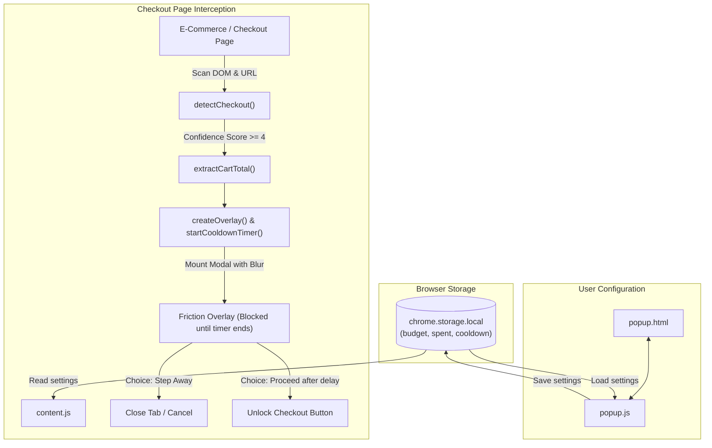

# CheckoutGuard Prototype: Architectural Design & Specification

> **Project Goal:** A lightweight Chrome extension (Manifest V3) designed to prevent impulsive overspending at checkout through automated checkout detection, price extraction, and behavioral friction (cooldown timers and budget impact warnings).
>
> **Scope:** All files are strictly contained within `/home/emil/__EMIL__/uni/WACK/WHACK26/checkout-guard/`. Total file count is deliberately kept minimal (6 files).

---

## 1. Directory Structure

```
checkout-guard/
├── ARCHITECTURE.md       # (This file) Complete technical specification
├── manifest.json         # Extension manifest (MV3 configuration and permissions)
├── content.js            # Content script: detection, scraping, friction overlay
├── content.css           # Styling for the injected friction overlay modal
├── popup.html            # Extension popup user interface (budget & timer settings)
├── popup.js              # Popup controller logic and storage synchronization
└── test-checkout.html    # Standalone mock checkout page for offline testing & demos
```

### Why this directory layout?
- **Zero build steps:** Standard vanilla HTML, CSS, and JS. Can be loaded directly into Chrome via **Developer mode -> Load unpacked** with zero dependencies or node compilation needed.
- **Strictly minimal footprint:** 6 files total. Avoids unnecessary subfolders (like `css/`, `js/`, `assets/`) to keep the prototype immediately readable and easy to navigate for evaluation.

---

## 2. File & Method Breakdown

---

### File 1: `manifest.json`
* **Purpose:** The root configuration file required by Google Chrome to register the extension, its permissions, and content scripts.
* **Why it is needed:** Chrome Manifest V3 entrypoint. Without this, Chrome cannot load the extension.
* **Permissions used & rationale:**
  * `"storage"`: Used to persist user budget thresholds, monthly spend, and cooldown timer preferences across browser sessions.
  * `"activeTab"`: Grants temporary access to interact with the current active checkout page without requiring invasive full-browser surveillance permissions.
  * `<all_urls>` host match for `content_scripts`: Necessary because checkout pages exist across arbitrary domains.

---

### File 2: `content.js`
* **Purpose:** Runs directly inside the target webpage. Continuously checks if the user is on a checkout flow, extracts the current order total, and injects an un-dismissible behavioral friction overlay.
* **Why it is needed:** Webpages cannot communicate with Chrome extensions unless a content script is present in the DOM.

#### Methods & Functions:

#### 1. `detectCheckout(): { isCheckout: boolean, score: number, signals: string[] }`
* **Why:** Determines with high confidence whether the current page is an authentic e-commerce checkout or payment gateway without false-triggering on normal catalog browsing or search results.
* **Arguments:** None (reads `window.location` and `document`).
* **Returns:** 
  * `isCheckout` (boolean): `true` only when the aggregate score meets the elevated threshold (`score >= 10`) AND at least 2 distinct strong confirmation categories are verified.
  * `score` (number): Aggregate confidence score based on signals detected.
  * `signals` (string[]): List of detected triggers for debugging and logging.
* **Specialized Amazon & E-Commerce Guardrails:**
  1. *Amazon Browsing Exclusions*: If browsing elements are present (`#twotabsearchtextbox`, `#add-to-cart-button`, `#buy-now-button`, `.s-search-results`), the extension immediately suppresses detection unless the user is specifically on Amazon's Single Page Checkout (`#placeYourOrder` / `/gp/buy/spc/`).
  2. *Product Page Guardrail*: Pages with active "Add to Cart" or "Add to Basket" buttons and search bars without active payment credentials or explicit checkout containers are disqualified as browsing pages.
  3. *Element Visibility*: Hidden elements (e.g., hidden slide-out carts or offscreen forms) are ignored using `isElementVisible()`.
  4. *Multi-factor Confirmation*: Requires co-occurrence of explicit checkout containers (+5), strict checkout URL paths (+4), visible credit card fields (+5), or high-intent final order buttons like "Place Order" / "Complete Purchase" (+5). Score must reach 10+ with 2+ categories confirmed.

#### 2. `extractCartTotal(): number | null`
* **Why:** Allows the extension to show the user how this specific purchase impacts their remaining budget allowance.
* **Arguments:** None (reads DOM elements).
* **Returns:** `number` (parsed currency amount, e.g., `49.99`) or `null` if no price could be determined with certainty.
* **Implementation logic:**
  * Checks standard semantic tags (`[data-checkout-total]`, `.order-summary__total`, `#order-total`).
  * Falls back to a currency regex (`/[$£€]\s*([0-9]+(?:\.[0-9]{2})?)/i`) targeting elements near keywords like "Total" or "Subtotal".

#### 3. `isAlreadyInjected(): boolean`
* **Why:** Prevents duplicate modal dialogs from being added if `MutationObserver` triggers multiple times during dynamic single-page app (SPA) page updates.
* **Arguments:** None.
* **Returns:** `boolean` (`true` if `#checkout-guard-overlay` element exists in the DOM).

#### 4. `createOverlay(cartTotal: number | null, budgetSettings: object): HTMLElement`
* **Why:** Constructs and mounts the non-bypassable friction modal into the webpage DOM.
* **Arguments:**
  * `cartTotal` (`number | null`): The detected purchase price.
  * `budgetSettings` (`object`): Current user preferences (`monthlyBudget`, `currentSpent`, `cooldownSeconds`).
* **Returns:** `HTMLElement` (the constructed overlay node).
* **UI Elements created inside overlay:**
  * **Warning Banner:** Shows detected price (e.g., "£45.00 purchase detected").
  * **Budget Impact Gauge:** Shows current balance vs. post-purchase balance (e.g., "This purchase uses 30% of your remaining £150 allowance").
  * **Countdown Timer:** Non-dismissible countdown (e.g., 30s) encouraging the user to pause and reflect.
  * **Action Buttons:**
    * "Step away (Close Tab)" — Closes or redirects away from the impulse buy.
    * "Proceed to Purchase" — Disabled until the countdown timer expires.

#### 5. `startCooldownTimer(durationSeconds: number, onComplete: function): void`
* **Why:** Enforces the behavioral friction period. Prevents premature clicks on checkout forms.
* **Arguments:**
  * `durationSeconds` (`number`): Number of seconds user must wait (e.g., 30).
  * `onComplete` (`function`): Callback executed when timer reaches 0, which unlocks the "Proceed" button.
* **Session Approval & Infinite Lockout Prevention:**
  * When the user clicks "Continue to Checkout", a session flag (`sessionStorage.setItem("cg_session_checkout_approved", "true")`) is stored, and the `MutationObserver` is disconnected.
  * This guarantees the user is **not** locked out repeatedly on the same checkout page and can freely finalize their purchase.

#### 6. `initCheckoutGuard(): void`
* **Why:** Main lifecycle controller. Runs when the content script loads, checks session approval status, executes fast-path domain/URL filters to ensure **zero browser lag**, reads configuration from `chrome.storage.local`, and injects the overlay if active.
* **Performance Optimizations:**
  * *Fast-Path Exit:* If the page URL lacks shopping/checkout keywords and contains no payment iframes, DOM scanning is completely bypassed.
  * *Native Visibility:* Uses modern browser C++ `el.checkVisibility()` instead of forced layout recalculations (`getComputedStyle`/`getBoundingClientRect`), completely eliminating UI stutter on catalog browsing.

---

### File 3: `content.css`
* **Purpose:** Encapsulates styles for the friction overlay injected into the host page.
* **Why it is needed:** The overlay must be visually isolated from host page styles (reset CSS styles, high `z-index: 2147483647` so it cannot be occluded, background blur filter `backdrop-filter: blur(8px)` to obscure distracting purchase triggers).

---

### File 4: `popup.html`
* **Purpose:** The user interface shown when clicking the extension icon in the Chrome toolbar.
* **Why it is needed:** Allows the user to configure their personal spending controls, view their remaining monthly budget, and toggle the extension on/off.
* **Sections included:**
  * **Status Header:** Active/Disabled switch.
  * **Monthly Budget Input:** Set total limit (e.g., £250.00).
  * **Current Spend Tracker:** Displays amount spent so far and progress bar.
  * **Cooldown Duration Selector:** Select friction pause (15s, 30s, 60s, or 5 minutes).
  * **Save / Reset Buttons:** Persist settings or reset for demonstration purposes.

---

### File 5: `popup.js`
* **Purpose:** Handles event listeners and data synchronization between `popup.html` and `chrome.storage.local`.
* **Why it is needed:** MV3 disallows inline script execution; all user interactions in the popup must be handled via an external JavaScript file.

#### Methods & Functions:

#### 1. `loadSettings(): Promise<object>`
* **Why:** Fetches stored user budget, current expenditure, and timer settings from `chrome.storage.local` upon opening the popup, filling in default values if not yet configured.
* **Arguments:** None.
* **Returns:** `Promise<object>` containing `{ monthlyBudget, currentSpent, cooldownSeconds, isEnabled }`.

#### 2. `saveSettings(): Promise<void>`
* **Why:** Reads user inputs from the popup form, validates them, and writes the updated values to `chrome.storage.local`.
* **Arguments:** None.
* **Returns:** `Promise<void>`.

#### 3. `updateUI(state: object): void`
* **Why:** Renders the budget progress bar, remaining allowance number, and formatted currency labels on screen.
* **Arguments:** `state` (`object` with `monthlyBudget` and `currentSpent`).
* **Returns:** `void`.

#### 4. `resetDemo(): Promise<void>`
* **Why:** Helper method that resets spend figures back to initial demo values (£120 spent out of £300 budget) for quick presentation and testing.
* **Arguments:** None.
* **Returns:** `Promise<void>`.

#### 5. `bindEvents(): void`
* **Why:** Attaches DOM event listeners (`click`, `input`, `change`) to form controls and buttons in `popup.html`.
* **Arguments:** None.
* **Returns:** `void`.

---

### File 6: `test-checkout.html`
* **Purpose:** A self-contained mock e-commerce checkout page with realistic shopping cart elements, credit card fields, and a "Place Order" button.
* **Why it is needed:**
  * Enables **100% offline, reproducible testing** without needing to enter a real e-commerce site or provide real payment details.
  * Ideal for pitch demos (e.g., open `test-checkout.html` in Chrome, click to checkout, and watch CheckoutGuard immediately intercept and trigger the reflection cooldown).

---

## 3. Communication & Data Flow



---

## 4. Verification & Testing Plan
1. **Load Extension:** Load unpacked `/checkout-guard` into `chrome://extensions`.
2. **Configure Settings:** Click extension icon, verify `popup.html` loads, change budget to £200, cooldown to 10 seconds, click Save.
3. **Open Mock Page:** Open `test-checkout.html` in Chrome.
4. **Trigger Interception:** Verify `content.js` automatically detects checkout triggers (`score >= 4`), displays the blurred modal with extracted total, and counts down 10 seconds before unlocking.
