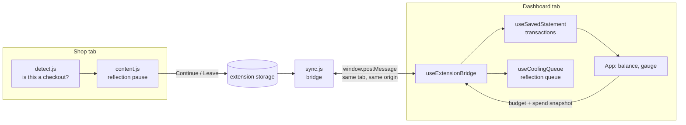

# Adaptive Credit Guard — project documentation

A hackathon prototype for Capital One's *Making Credit Accessible* challenge. It has two parts that work together:

- **Dashboard** (`src/`): a simulated UK credit card account in React. It shows a balance gauge, what-if purchase previews, a 30-minute reflection queue for paused purchases, a written "Request Grace" support flow and bank statement analysis.
- **CheckoutGuard** (`checkout-guard/`): a Chrome/Firefox extension. It notices checkout pages, shows a reflection pause with your budget, and reports what you did back to the dashboard.

It's designed around barriers that people with dyscalculia, ADHD, executive dysfunction or phone anxiety meet when managing credit. The pitch, persona and judge Q&A are in [`project-brief.md`](../project-brief.md). To run it, see [LAUNCH.md](LAUNCH.md).

Nothing connects to a bank, a lender or any server. All data stays in the browser.

---

## Contents

1. [How the pieces fit](#how-the-pieces-fit)
2. [Money rules](#money-rules)
3. [Dashboard](#dashboard)
4. [CheckoutGuard extension](#checkoutguard-extension)
5. [Extension ↔ dashboard sync](#extension--dashboard-sync)
6. [Stored data](#stored-data)
7. [Testing and CI](#testing-and-ci)
8. [Privacy and security](#privacy-and-security)
9. [File map](#file-map)
10. [Known limits](#known-limits)

---

## How the pieces fit



`sync.js` only runs on the dashboard's own tab, at `http://localhost` or `http://127.0.0.1` on ports **5173, 4173 or 3000**. Messages never leave that tab.

## Money rules

- **All amounts are integer pence** (`28000` = £280). Pounds only exist at the edges: typed input is parsed by `parsePoundsToPence` and displayed with `formatMoney`. No floating-point money maths.
- **Balance = amount owed.** Purchases from this month (statement rows, manual entries, checkouts from the extension) are **added** to the starting balance, like spending on a real card. The what-if preview uses the same direction, so a £50 preview and a real £50 purchase show the same number. Removing a transaction undoes it.
- **Only the current calendar month counts** (browser local time). Older months, unknown dates and removed rows are ignored. The total is recalculated each time from the transaction list, never kept as a running total, so a refresh can't double-count.
- **One money model, one headline number: "Safe to spend".** The *safe limit* is the chosen target share of the card limit (30% of £1,000 = £300). *Safe to spend* = safe limit − what you owe (£300 − £280 = **£20.00**), never below £0; past it, the app says "£X over your safe limit". The dashboard, the checkout popup and the toolbar popup all use exactly these words and this maths (`getGaugeState` in `src/account.js`, `impact` in `checkout-guard/core.js`). `test/extension-contract.test.js` fails if they ever differ. Built for people with dyscalculia: no second figure to reconcile.
- **No percentages in the default (Simple) view.** One bar (share of the safe limit used, never past full) plus words. Screen readers get the same words. Percentages appear only in the optional **Detailed view**.
- **Colour bands, same on both sides:** green while you owe less than 80% of the safe limit ("Within your safe limit"), amber from 80% up to the limit ("Close to your safe limit"), red over it ("Over your safe limit"). The dashboard also says "Over your card limit" above the card limit. These are interface bands, **not** a credit-score prediction.
- **Shared numbers:** the dashboard sends the extension its safe limit and what you owe. While a dashboard tab is open, those always win: if the toolbar popup's numbers are edited or reset, they snap back. With no dashboard open, the extension uses its own saved numbers and adds each Continue to what you owe.
- **Money always shows pence** (`£280.00`, never `£280.5`), on both sides.

## Dashboard

React 19 and Vite 7, with no router and no state library. `App.jsx` holds the shared state and passes it down. Screens stay mounted when you navigate, so drafts aren't lost.

| Feature | What it does | Main files |
|---|---|---|
| Safe to spend (top card) | Headline **Safe to spend**, a status in words, the sum behind it (Safe limit − You owe = Safe to spend) and one bar. Same number and words as the extension. What you owe = starting balance + this month's purchases. **Detailed view** (⚙ Settings, remembered) adds card limit, this month's purchases, % of card and safe limit used, and the colour key. The headline is identical in both views. | `AccountOverview.jsx`, `account.js`, `statements/monthlyBalance.js` |
| Try a purchase first | Type an amount to see "After this: £X safe to spend" or "£X over your safe limit". Never changes the account. | `SafeZoneGauge.jsx`, `PurchaseProjection.jsx` |
| Reflection queue | Checkouts paused by the extension, kept for 30 minutes. "I don't need this" removes an item and adds it to **Total Impulse Money Saved**. | `ImpulseCoolingQueue.jsx`, `coolingQueue.js`, `hooks/useCoolingQueue.js` |
| Request Grace | Draft → edit → review → disclaimer and consent → send → status updates. The decision is simulated at random and doesn't predict a real lender. | `RequestGrace.jsx`, `grace.js` |
| Statement analysis | Upload a text-based GBP bank statement PDF (or load the demo statement). Rows are extracted locally, categorised and reconciled against the statement's own total. You can change categories, include/exclude rows and add transactions manually. | `StatementAnalysis.jsx`, `AddTransactionForm.jsx`, `statements/*` |
| Home spending summary | This month's saved transactions on Home, with Remove/restore. | `HomeSpendingSummary.jsx` |
| Demo controls | Presenter-only: starting balance, credit limit, target %. | `DemoControls.jsx` |
| Accounts | **Log in / Create account / Log out / Continue without an account.** Header shows "Signed in as …" or "Guest". Each account's money data is kept separately in this browser; nothing financial goes to the server. Without a running server the app opens as a guest automatically. See [Accounts server](#accounts-server). | `AccountGate.jsx`, `AuthScreen.jsx`, `auth/*`, `server/*` |
| ⚙ Settings, menu, reset | One Settings menu with switches for **Dark mode**, **Detailed view** and **Dyslexia-friendly font (OpenDyslexic)**, all remembered and kept across Reset demo. The font is bundled (works offline) and also switches the extension's popups. ☰ Menu for navigation; **Reset demo** clears everything else. | `SettingsMenu.jsx`, `NavigationMenu.jsx` |

### Statement import

- PDF.js runs in the browser with its bundled worker. The file is read in memory and never uploaded or saved; only the extracted rows are saved.
- The importer finds separate outgoing/incoming columns ("Paid out/Paid in", "Money out/Money in", "Payments out/in", Nationwide's "£Out/£In", "Debit/Credit", "Withdrawals/Deposits") and uses each amount's position to skip incoming payments and running balances.
- Limits: 20 MB, 100 pages, text PDFs only. Scanned, password-protected and non-GBP statements aren't supported.
- A detected summary total is compared with the extracted total. A mismatch or missing total is shown for review. A match is a useful check, not a guarantee.
- Dates use the printed year, or the statement period when the bank leaves the year out. They never silently use the current year.
- Categories come from general keyword rules (`categories.js`). Anything unknown goes to **Other / needs review**.

## CheckoutGuard extension

One Manifest V3 folder for Chrome and Firefox 142+. No bundler, no background worker, no remote code. The only permission is `storage`. Content scripts load in this order on every page:

| File | Role |
|---|---|
| `core.js` | Shared by the popup and content scripts: pence and GBP parsing, settings validation and defaults, budget maths, storage (Firefox promises / Chrome callbacks with `runtime.lastError`), purchase and reflection queues, shop approvals, dashboard snapshot. |
| `detect.js` | Read-only checkout detection and GBP total extraction. |
| `sync.js` | Bridge to the dashboard tab (allowed origins only). |
| `content.js` | Reflection popup, timer, focus trap and page lifecycle. |
| `popup.html/.css/.js` | Toolbar popup: budget, spend, pause length, on/off. |
| `content.css` | Styles scoped to the injected popup, with reduced-motion support. |
| `test-checkout.html` | Fake shop for testing. It never submits a payment. |
| `icons/` | Toolbar and extensions-page icon (16/32/48/128 px). |
| `fonts/` | OpenDyslexic 400/700 (`woff2`) with its OFL licence. Listed as web-accessible so the checkout popup can use it on shop pages. A shop with a strict font policy can block it; the popup then keeps the normal font. |

### Detection (`detect.js`)

- A page is a checkout only with a **score ≥ 10 from at least two kinds of signal**: checkout containers, checkout URLs, payment fields being present, final-order buttons and visible totals.
- Search engines, social media, wikis and similar sites are excluded by exact domain match, not substring.
- **Amazon** has its own rules: the checkout URL plus checkout header, or a visible "Place your order" button.
- **Shopify one-page checkouts** (for example GamerSupps) are recognised from the pay-button cluster and the hosted card-field iframes, without reading inside them.
- **Totals:** an explicit total element wins. A foreign-currency total never falls back to some other GBP price on the page. If no GBP total is found, the user types the amount; there's no guessing and no currency conversion.
- Card numbers and CVVs are never read; only whether the fields are present is checked.

### Performance safeguards (keep these)

These were added to stop CPU spikes and layout thrashing across many open tabs. The browser test checks the first two.

- **Product-page fast path:** pages with no checkout URL, container or payment field skip all button visibility and layout reads, because they can't reach the threshold anyway.
- **Hidden-tab deferral:** background tabs don't scan until they become visible (unless a popup is already open).
- **Debounced scanning:** DOM changes trigger at most one scan per 200 ms, and changes inside the extension's own popup are ignored to avoid feedback loops.
- **Cheap URL watching:** single-page-app navigation is caught by checking `location.href` every 750 ms, without patching the site's History API.
- **Absolute-deadline timer:** the pause ends at a fixed time, so a throttled background tab doesn't stretch it.

### Pause lifecycle (`content.js`)

1. A checkout is detected, so the popup opens with the order total, "Already spent", the remaining budget and a gauge. The default pause is 15 s, configurable 1–300 s.
2. **Continue to checkout** (enabled after the pause): adds the amount to "Already spent", queues the purchase for the dashboard, and **approves this shop for 30 minutes**, so the address → payment → review pages don't pause again or log the order twice.
3. **Close (×) / Escape:** dismisses the popup and approves the shop the same way, but records no purchase.
4. **Leave checkout:** saves the order to the reflection queue (30 minutes) and goes back a page. It doesn't approve the shop, so returning brings the pause back.
5. **Reset demo** on the dashboard, or **Reset** in the toolbar popup, forgets all approved shops so the pause shows again.
6. Turning the guard off closes any open popup. Settings changes update an open popup immediately.

The popup traps Tab focus, supports Escape, restores focus afterwards and announces status to screen readers. All page text is inserted with `textContent`; nothing from the page or from storage is placed into HTML.

## Extension ↔ dashboard sync

All messages are `window.postMessage` within the dashboard tab. Both sides check `event.source === window`, the exact origin, and a `source` tag (`checkout-guard-extension` / `credit-guard-dashboard`).

| Direction | Message | Meaning |
|---|---|---|
| ext → dash | `bridge-ready` | Extension loaded in this tab. The dashboard replies with `ready` and a `snapshot`. |
| dash → ext | `ready` | Dashboard can receive. The extension delivers everything pending. |
| ext → dash | `purchase` `{version, id, amount, currency:'GBP', merchant, date}` | Saved as a "planned checkout" transaction, then acknowledged. |
| dash → ext | `purchase-saved` `{id}` | Saved for good, so the extension deletes its pending copy. |
| ext → dash | `cooling-item` `{version, id, title, store, amount, savedAt, expiresAt}` | Added to the reflection queue, then acknowledged. |
| dash → ext | `cooling-item-saved` `{id}` | As above. |
| dash → ext | `preferences` `{font}` | Font choice (`default`/`dyslexic`). Both extension popups switch font. Sent on start-up and when it changes. |
| dash → ext | `reset` | Reset demo was pressed. The extension forgets approved shops. |
| dash → ext | `snapshot` `{monthlyBudget, currentSpent}` (pence) | The extension takes these as its budget and spend. Sent on start-up and whenever they change. |

Reliability:

- Each purchase and paused item is stored under its own key, so two tabs at once can't overwrite each other.
- Pending items are re-sent every 5 s until acknowledged.
- The dashboard keeps a list of received IDs (IDs only) that survives **Reset demo**, so a late retry can't bring back a cleared purchase.
- If the dashboard is closed, items wait in the extension until it opens.

The extension and dashboard each check incoming data with their own validators. The extension can't import from `src/`, so the checks are duplicated on purpose. `test/extension-contract.test.js` fails if the two copies ever disagree.

All of the dashboard's bridge code is in `src/hooks/useExtensionBridge.js`. To support a deployed dashboard, add its exact origin to the allowlist in `checkout-guard/sync.js`.

## Accounts server

`server/index.js` is a zero-dependency Node server (`npm run server`, port 4173). It serves `dist/` and a small JSON API. **Local demo only:** plain HTTP, never deploy as-is. Full design and reasoning: [BACKEND-PLAN.md](BACKEND-PLAN.md).

| Method + path | Does |
|---|---|
| `GET /api/health` | Server is up |
| `POST /api/register` `{username, password}` | Creates the account and logs in (`201`; `409` if the name is taken) |
| `POST /api/login` `{username, password}` | Logs in (`401` "Username or password is wrong"; `429` after 5 failures in 15 min) |
| `POST /api/logout` | Ends the session |
| `GET /api/me` | Who's logged in (`401` if nobody) |

- **Stored** in `server/data/users.json` (gitignored): user ID, lowercase username, **scrypt** password hash, and **SHA-256 hashes** of session tokens. No money data.
- **Session cookie** `cg_session`: HttpOnly, SameSite=Lax, 7 days.
- **Protection:** `POST` needs JSON and a same-site `Origin`; bodies ≤ 16 KB; unknown users and wrong passwords get the same answer and timing; files outside `dist/` are never served; a corrupt accounts file stops the server instead of being overwritten.
- **In the browser** (`src/auth/`): `api.js` never throws (no server → "offline" → guest mode); `useAuth.js` holds the login state; `scopedStorage.js` prefixes the existing storage keys with `credit-guard-user:<id>:` per account (guests use the original keys); `AccountGate.jsx` picks the log-in screen or the dashboard and remounts it per account.
- **The extension is unchanged.** It syncs with whichever account is open on the dashboard tab. Purchases made while logged out wait and go to the next account that opens the dashboard in that browser.

## Stored data

**Dashboard (`localStorage`)**

| Key | Holds | Cleared by Reset demo |
|---|---|---|
| `credit-guard-statement-v1` | Imported, manual and checkout transactions, plus filename and selections | Yes |
| `credit-guard-cooling-v1` | Reflection queue items and money saved | Yes |
| `credit-guard-checkout-receipts-v1` | IDs of received purchases (prevents replays) | No, on purpose |
| `credit-guard-theme` | Light/dark choice | No |
| `credit-guard-view` | Simple/Detailed view choice | No |
| `credit-guard-font` | Normal/OpenDyslexic font choice | No |

For a signed-in account, the first three keys are prefixed with `credit-guard-user:<user id>:` so each account has its own copy. Guests use them as shown. Display settings are shared by everyone on the browser.

The account itself (balance, limit, target, support request) lives in memory only and goes back to the demo values when the page reloads.

**Extension (`storage.local`)**

| Key | Holds |
|---|---|
| `isEnabled`, `monthlyBudget`, `currentSpent`, `cooldownSeconds` | Settings (stored in pounds for backwards compatibility; all maths in pence) |
| `checkoutGuard.purchase.<id>` | A purchase waiting for the dashboard |
| `checkoutGuard.cooling.<id>` | A paused checkout waiting for the dashboard |
| `checkoutGuard.approved.<hostname>` | Time until which that shop won't pause again (30 min) |
| `checkoutGuard.font` | `default` or `dyslexic`, set by the dashboard's Settings |

## Testing and CI

| Command | Covers |
|---|---|
| `npm test` | 53 Node tests, including the accounts server (real HTTP requests: register, login, logout, validation, origin/size checks, brute-force limit, hashing, path traversal, corrupt-file guard) and the browser accounts client: money parsing, gauge bands, balance maths, statement parsing and dates, storage, checkout sync, cooling queue, extension core (Chrome and Firefox storage, budgets, approvals, snapshot) and the extension ↔ dashboard contract. |
| `npm run lint:extension` | Mozilla `web-ext lint` on `checkout-guard/`. |
| `npm run test:browser` | Playwright + real Chromium, about 1 minute: the dashboard flows on the built `dist/` (served from a sub-folder), extension popup behaviour with simulated storage, detection fixtures (Amazon, Shopify/GamerSupps, product pages, hidden tabs), the toolbar popup, and **the real extension loaded next to the dashboard** checking the same "safe to spend" number on both sides, Continue, shop approval, Reset demo, the toolbar popup snapping back to the dashboard's numbers, and Leave → reflection queue. Fails on any JavaScript error in the page. |
| `npm run pack:extension` | Unsigned ZIP in `web-ext-artifacts/`. |

GitHub Actions (`.github/workflows/check.yml`) runs all of these on every push and pull request. It also checks that `dist/` was rebuilt and committed. CI only reads; it never pushes or deploys.

## Privacy and security

- No analytics, no real payments or support messages. The only network requests are to the optional local accounts server, and they carry only usernames, passwords (stored only as hashes) and session cookies, **never money data**.
- The extension stores only amounts, shop hostnames, page titles and the font choice, never URLs, query strings or card details.
- Only the two font files are web-accessible (needed to show OpenDyslexic on shop pages).
- Bridge messages are restricted to the same tab and origin, and the extension bridges only to localhost dashboard ports.
- All data read from storage or messages is validated before use. Invalid stored settings fall back to defaults; a failed read never replaces your saved budget with a guess.

## File map

```
index.html                  page shell + extension marker <meta name="checkout-guard-dashboard">
src/main.jsx                starts React with AccountGate
src/AccountGate.jsx         log-in screen or dashboard (per account / guest)
src/auth/                   accounts client: api.js, useAuth.js, scopedStorage.js
server/                     optional accounts server (index.js, store.js, tests)
src/App.jsx                 layout, shared state, navigation, reset
src/account.js              demo account, pounds→pence parsing, safe-to-spend maths
src/grace.js                Request Grace status steps
src/coolingQueue.js         reflection queue rules + storage
src/components/             one file per panel (see Dashboard table)
src/hooks/
  useExtensionBridge.js     everything that talks to the extension
  useSavedStatement.js      transactions in localStorage
  useCoolingQueue.js        reflection queue in localStorage
  useCurrentMonth.js        re-renders when the month changes
src/statements/             PDF reading, parsing, dates, categories, selection,
                            manual + checkout transactions, monthly balance, storage
src/utils/format.js         £ and % formatting
src/style.css               all dashboard styles, light/dark tokens
checkout-guard/             the extension (see table above)
test/                       extension unit + contract tests
scripts/check-browser.py    Playwright browser test
dist/                       committed production build for the offline demo
docs/                       LAUNCH.md, PROJECT.md, REPO-FIX.md
project-brief.md            pitch, demo script, judge Q&A
```

## Known limits

- Prototype only: simulated account, random Grace decisions, no lender integration.
- Accounts are a local demo: plain HTTP, no password reset, email or account deletion. Money data is per browser, not synced between devices.
- The dashboard's account settings (balance, limit, target) reset on reload. Only transactions, the queue and the theme are saved.
- Checkout detection is strict to avoid false alarms, so some shops won't trigger it. Unknown totals fall back to typing the amount.
- Sync needs the dashboard open on a localhost port in the same browser profile.
- A shop approval is read when the page loads. If it expires while the page stays open, that's ignored until the next page load.
- Temporary Firefox add-ons disappear on restart. A permanent install needs Mozilla signing.
